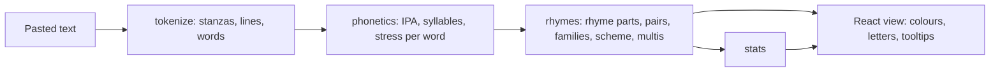

# Rymoskop - specification

## 1. Product

**One line:** paste Polish lyrics, see how they sound and how they rhyme.

**Users:** people who write or study lyrics and poetry (rap especially), and, for this portfolio, a recruiter who wants to see a working tool whose output is verified.

### User stories (v1)

1. I paste a text (or click "Wczytaj przykład") and the analysis updates as I type.
2. Every word that takes part in a rhyme is coloured by its rhyme family, and also marked in a way that does not rely on colour.
3. Each line shows its syllable count and its end-rhyme letter (A, B, C...; `x` when it rhymes with nothing).
4. I can switch on "Fonetyka" to see the IPA transcription under every word.
5. Hovering or focusing a word shows: IPA, syllables with the stressed one marked, the rhyme part, and the words it rhymes with (with rhyme type).
6. A statistics panel shows the numbers from section 6.
7. Section labels such as `[Refren]`, `[Zwrotka 2]` or `Refren:` are not analysed as lyrics.

Out of scope for v1: English, accounts, saving to the cloud, sharing links, AI features, editing the phonetic transcription by hand.

## 2. Architecture

Static single-page app. No server. All analysis in the browser.



Folder layout (target):

```
src/lib/text/tokenize.ts
src/lib/phonetics/      graphemes.ts, rules.ts, syllables.ts, stress.ts, exceptions.ts, index.ts
src/lib/rhymes/         rhymePart.ts, compare.ts, endRhymes.ts, multis.ts, internal.ts, families.ts, index.ts
src/lib/stats/index.ts
src/lib/analyze.ts      the single entry point: analyze(text) -> Analysis
src/components/         Editor, AnalysisView, Line, Word, WordTooltip, StatsPanel, Legend
scripts/                ipa.ts, analyze.ts, eval.ts
tests/                  unit tests per module
tests/gold/             phonetics.json, rhymes.json (approved by Marcin)
eval/poems/             public-domain poem fragments with expected schemes
```

## 3. Data model (TypeScript, simplified)

```ts
type Phoneme = string;                     // one IPA segment, e.g. "ʂ", "t͡ɕ", "ɔ̃"
type Syllable = { phonemes: Phoneme[]; nucleus: number };   // index of the vowel in phonemes
type WordPhonetics = { text: string; normalized: string; phonemes: Phoneme[]; syllables: Syllable[]; stress: number /* syllable index */; ipa: string /* e.g. "ˈʐɛ.ka" */ };
type Token = { id: string; line: number; index: number; text: string; phonetics: WordPhonetics | null /* null for numbers, symbols */ };
type Line = { index: number; stanza: number; tokens: Token[]; isLabel: boolean };
type RhymeType = "exact" | "near" | "assonance";
type RhymeLink = { a: string; b: string; type: RhymeType; kind: "end" | "internal" | "multi"; syllables: number };
type Analysis = { lines: Line[]; links: RhymeLink[]; families: Record<string /* token id */, number /* family */>; scheme: string[] /* per line */; multis: Multi[]; stats: Stats };
```

## 4. Polish phonetics (approximate standard pronunciation)

Pipeline per word: normalise (lowercase, strip punctuation, keep letters incl. ą ć ę ł ń ó ś ź ż) -> graphemes -> phonemes -> voicing rules -> syllables -> stress.

### Graphemes to phonemes

| Spelling | IPA | Notes |
| --- | --- | --- |
| a, e, i, o, u/ó, y | a, ɛ, i, ɔ, u, ɨ | |
| ą, ę | ɔ̃, ɛ̃ | see nasal rules |
| ch, h | x | |
| cz, sz, rz, ż | t͡ʂ, ʂ, ʐ, ʐ | rz after p, t, k, ch is voiceless ʂ (przy, trzy, krzak) |
| c, dz, dż, dź | t͡s, d͡z, d͡ʐ, d͡ʑ | |
| ć, ś, ź, ń | t͡ɕ, ɕ, ʑ, ɲ | |
| ci, si, zi, ni, dzi + vowel | t͡ɕ, ɕ, ʑ, ɲ, d͡ʑ | the i is only softening, not a vowel (nie = 1 syllable) |
| ci, si, zi, ni, dzi + consonant or end | t͡ɕi, ɕi, ʑi, ɲi, d͡ʑi | i is a vowel (nic, ci) |
| other consonant + i + vowel (pi, bi, mi, wi, fi, ki, gi, li) | palatalised consonant + j | miasto ˈmjas.tɔ; i is not a vowel |
| ł, w, l, r, j, m, n | w, v, l, r, j, m, n | |

### Nasal vowels (simplified)

- ę at the end of a word -> ɛ (idę ˈi.dɛ).
- ą, ę before p, b -> ɔm, ɛm; before t, d, t͡s, d͡z, t͡ʂ, d͡ʐ -> ɔn, ɛn; before t͡ɕ, d͡ʑ -> ɔɲ, ɛɲ; before k, g -> ɔŋ, ɛŋ (ząb zɔmp, ręka ˈrɛŋ.ka).
- ą, ę before l, w -> ɔ, ɛ (wziął vʑɔw).
- Otherwise ɔ̃, ɛ̃.

### Voicing

- Final devoicing: a voiced obstruent at the end of a word becomes voiceless (chleb xlɛp, róg ruk, mróz mrus, też tɛʂ).
- Regressive assimilation in obstruent clusters inside a word: the cluster takes the voicing of its last obstruent (wódka ˈvut.ka, prośba ˈprɔʑ.ba).
- v and ʐ (from w, rz) after a voiceless obstruent become f and ʂ (twój tfuj, krzak kʂak).
- Do not apply assimilation across word boundaries in v1.

### Syllables and stress

- Syllable nuclei: a, ɛ, i, ɔ, u, ɨ, ɔ̃, ɛ̃. One syllable per nucleus.
- Consonants between nuclei go to the next syllable (onset maximisation), except that a single consonant before another consonant cluster may stay in the coda. The exact split does not affect rhymes; keep the rule simple and documented.
- Stress: penultimate syllable; monosyllables are stressed. No other exceptions in v1.
- `exceptions.ts`: a small dictionary of words whose spelling misleads the rules, mostly loanwords common in Polish rap (e.g. flow, beat, hip-hop, rap, show, cool). Marcin approves every entry.

## 5. Rhymes

### Rhyme part

The rhyme part of a word is its phonemes from the nucleus of the stressed syllable to the end (ręka -> ɛŋ.ka, kot -> ɔt). This is the standard definition for Polish (penultimate stress gives "feminine" rhymes).

### Comparing two rhyme parts

| Type | Rule | Example |
| --- | --- | --- |
| exact | identical phonemes | ręka / męka |
| near | same vowels in the same order, and consonants that differ only by voicing, by being in the same class (two nasals, two sibilants), or by one consonant added or missing at the end | góra / córka (vowels u-a, consonants close) |
| assonance | same vowels only | lato / kawa |
| none | anything else | |

- A word does not rhyme with itself (same normalised form): that is a repetition, reported separately.
- Very short function words (i, a, w, z, na, do, się, nie, to, że, by, od, po, o, u) never take part in rhymes.

### End rhymes and scheme

- The end word of a line is its last token with phonetics.
- Stanzas are separated by a blank line. Within a stanza, line n gets the letter of the first earlier line it rhymes with (exact or near); otherwise the next free letter. A letter used by only one line becomes `x`.

### Multisyllabic rhymes (rap "wielokrotne")

- For each pair of lines up to 4 lines apart, compare the vowel sequences of their last N syllables across word boundaries, for N from 2 to 6.
- The longest N where the vowels match and the final rhyme parts are exact, near or assonance is a multi of length N. Store both fragments.

### Internal rhymes

- Two content words in the same line, or one in a line and one in the next line, whose rhyme parts are exact or near, and which are not both line-end words.

### Families

- Union-find over all links (end, internal, multi). Each connected group of tokens is one family with one colour and one letter in the legend.

## 6. Statistics

| Stat | Definition |
| --- | --- |
| Lines, stanzas, words, syllables | counts, labels excluded |
| Syllables per line | average, min, max, and the per-line list |
| Scheme | per stanza, e.g. AABB, ABAB, AxAx |
| Lines with an end rhyme | share of lines whose letter is not `x` |
| Rhyme density | syllables that belong to any rhyme part or multi fragment / all syllables |
| Rhyme types | counts of exact, near, assonance links |
| Longest multi | length in syllables and both fragments |
| Vocabulary richness | unique normalised words / all words |

## 7. Quality

- `tests/gold/phonetics.json`: about 60 words covering every rule in section 4, each with expected IPA, syllable count and stress index. **Marcin approves each entry.**
- `tests/gold/rhymes.json`: about 60 word pairs with the expected type, including clear negatives. **Marcin approves each entry.**
- `eval/poems/*.txt`: 5-8 public-domain poem fragments. First lines are a header with author, title, source and the expected end-rhyme scheme per stanza.
- `npm run eval` reports: IPA exact-match rate, syllable-count accuracy, stress accuracy, rhyme-pair accuracy (with a confusion table), scheme accuracy on the poems; writes `eval/results.md`.
